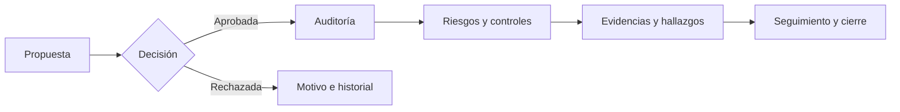

<p align="center"></p>

<h1 align="center">VERA · auditoría, riesgo y evidencia</h1>

<p align="center">Un recorrido verificable desde la propuesta hasta el seguimiento.</p>

<p align="center">
  
  
  
</p>

<p align="center">
  <a href="https://github.com/VERA-GRC-IRM/VERA/wiki">Centro de conocimiento</a> ·
  <a href="https://vera-grc-irm.github.io/VERA/">Plataforma de calidad de software</a> ·
  <a href="https://github.com/VERA-GRC-IRM/VERA/releases">Cortes verificables</a> ·
  <a href="https://www.vera-digital-systems.com/acerca">Conoce VERA</a> ·
  <a href="https://www.youtube.com/shorts/X2RuivSwSVo">Tráiler de VERA</a> ·
  <a href="https://github.com/VERA-GRC-IRM/VERA/actions/workflows/classroom-quality.yml">Ver calidad completa</a> ·
  <a href="docs/testing/professor-quick-run.md">Guía de revisión de calidad</a>
</p>

> **VERA en video.** [Mira el tráiler en YouTube](https://www.youtube.com/shorts/X2RuivSwSVo) o [reprodúcelo en la presentación pública](https://www.vera-digital-systems.com/acerca#trailer-vera). La aplicación y la documentación de abajo permiten explorar el producto con más detalle.

> **Estado del proyecto.** VERA es un prototipo funcional en evolución, con código y pruebas automatizadas. El [sitio público de producto](https://www.vera-digital-systems.com/acerca) explica la solución antes del acceso; la [demo](https://www.vera-digital-systems.com/) se despliega desde `main` de esta organización. Consulta el [smoke vigente](https://github.com/VERA-GRC-IRM/VERA/actions/workflows/production-smoke.yml) y la [plataforma de calidad](https://vera-grc-irm.github.io/VERA/) para verificar el commit observado. Los resultados de CI y la disponibilidad pública acreditan solamente las comprobaciones ejecutadas; la [aceptación de producción pendiente](https://github.com/VERA-GRC-IRM/VERA/issues/113), el [corte funcional previo al siguiente sprint de IA](docs/functional-readiness-cut.md) y el [estado histórico por HU](docs/hu-acceptance-audit.md) delimitan lo que falta.

## Entregas y próximos pasos

| Vista | Qué muestra |
| --- | --- |
| [Cortes integrados](https://github.com/VERA-GRC-IRM/VERA/milestones?state=closed) | Tres hitos con PR ya fusionados. Un hito cerrado no equivale a aprobación en producción. |
| [Hito de aceptación abierto](https://github.com/VERA-GRC-IRM/VERA/milestone/4) | Verificaciones que faltan antes de afirmar aceptación funcional en producción. |
| [Tablero público de entrega y aceptación](https://github.com/orgs/VERA-GRC-IRM/projects/1/views/2) | Las verificaciones pendientes y su estado; nuevas issues abiertas de VERA se añaden automáticamente. |
| [Issue principal de aceptación](https://github.com/VERA-GRC-IRM/VERA/issues/113) | Seis verificaciones con evidencia de cierre definida, incluidas las dependencias de entorno. |
| [Azure Boards](https://dev.azure.com/FEMSA-GRC-IRM/FEMSA-GRC-IRM) | Historias de usuario y aceptación funcional del equipo; el tablero de GitHub no duplica ese backlog. |

No se asignaron fechas ni responsables que el equipo no haya acordado. El avance se actualiza al cerrar issues con evidencia del entorno correspondiente; consulta el [portal de calidad](https://vera-grc-irm.github.io/VERA/) para resultados recientes por commit.

## VERA en un minuto

| Pregunta | Respuesta de VERA |
| --- | --- |
| ¿Qué requiere atención? | Panel por rol con indicadores, matriz de riesgo, pendientes y acciones del portafolio. |
| ¿Cómo pasa una iniciativa a ejecución? | Propuesta → revisión y decisión → auditoría aprobada → seguimiento y cierre. |
| ¿Dónde está el sustento? | Riesgos y controles relacionados, hallazgos, archivos o referencias de evidencia, comentarios y actividad. |
| ¿Cómo se consulta el conjunto? | Búsqueda y filtros de auditorías; asistente de IA de consulta con fuentes visibles para cada usuario. |



El flujo se apoya en autorización del servidor y registros de actividad. La interfaz orienta al usuario; no sustituye los permisos de la API. El [centro de conocimiento](https://github.com/VERA-GRC-IRM/VERA/wiki) explica el recorrido, las reglas y sus límites.

El perfil Super Admin puede [recorrer las vistas reales de Auditor, Jefatura, Gerente y Director](docs/role-tour.md) desde el menú lateral. Las consultas usan los permisos y datos de cada rol; el recorrido es de solo lectura y tiene un regreso visible al perfil original.

## Explorar el producto

| Área | Qué permite hacer | Código principal |
| --- | --- | --- |
| **Panel de portafolio** | Consultar métricas, gráficas, auditorías y pendientes según el alcance del rol. | [Dashboard](frontend/src/pages/Dashboard.jsx) · [dashboardService](backend/services/dashboardService.js) |
| **Planificación** | Proponer auditorías, revisarlas y registrar aprobación o rechazo. | [Planificacion](frontend/src/pages/Planificacion.jsx) · [planningRoutes](backend/routes/planningRoutes.js) |
| **Auditorías** | Seguir expedientes activos, matriz 3 × 3 y búsqueda filtrada. | [AuditoriasActivas](frontend/src/pages/AuditoriasActivas.jsx) · [BuscarAuditorias](frontend/src/pages/BuscarAuditorias.jsx) |
| **Riesgos y controles** | Registrar evaluaciones versionadas, asociaciones y hallazgos. | [Riesgos](frontend/src/pages/Riesgos.jsx) · [Controles](frontend/src/pages/Controles.jsx) |
| **Evidencias y actividad** | Vincular referencias o archivos privados, consultar comentarios e historial. | [Evidencias](frontend/src/pages/Evidencias.jsx) · [auditRoutes](backend/routes/auditRoutes.js) |
| **Pendientes e IA** | Priorizar actividades, consultar información autorizada, crear propuestas, riesgos, controles, hallazgos, referencias y archivos privados de evidencia, comentarios y compromisos, decidir propuestas, cerrar hallazgos, cambiar estados y datos permitidos de auditorías, editar y evaluar riesgos y controles existentes, revisar solicitudes de rol como Super Admin, consultar cuentas según permisos, habilitar o deshabilitar cuentas como Super Admin con motivo y confirmación, leer y marcar avisos, y exportar el reporte del portafolio desde la conversación. Pregunta «¿Qué puedes hacer aquí?» para ver las opciones de tu rol. | [Notificaciones](frontend/src/pages/Notificaciones.jsx) · [Operar desde la conversación](docs/ai-command-center.md) · [Capacidades por rol](docs/ai-chat-capabilities.md) · [Propuestas desde el chat](docs/ai-chat-proposals.md) · [Registro de riesgos](docs/ai-chat-risk-create.md) · [Edición de riesgos y controles](docs/ai-chat-record-edit.md) · [Registro y cierre de hallazgos](docs/ai-chat-finding-create.md) · [Registro de controles](docs/ai-chat-control-create.md) · [Registro de evidencias](docs/ai-chat-evidence-create.md) · [Archivos como evidencia](docs/ai-chat-file-evidence.md) · [Comentarios desde el chat](docs/ai-chat-comments.md) · [Revisión de roles](docs/ai-chat-role-review.md) · [Avisos desde el chat](docs/ai-chat-notifications.md) · [Detalles de auditoría](docs/ai-chat-audit-details.md) · [Edición de auditoría](docs/ai-chat-audit-edit.md) · [Directorio de cuentas](docs/ai-chat-user-directory.md) · [Estado de cuentas](docs/ai-chat-user-status.md) · [Compromisos desde el chat](docs/ai-chat-actions.md) · [Planificación desde el chat](docs/ai-chat-planning.md) · [Evaluación de riesgos](docs/ai-chat-risks.md) · [Evaluación de controles](docs/ai-chat-controls.md) · [Reportes desde el chat](docs/ai-chat-reports.md) · [assistantRoutes](backend/routes/assistantRoutes.js) |

Puedes escribir una pregunta completa en la búsqueda superior y elegir «Preguntar a VERA» para abrir el chat sin salir de la pantalla. El texto queda listo para revisarlo y enviarlo; la selección por sí sola no ejecuta consultas ni cambios.

El asistente combina indicadores calculados por VERA con respuestas de Azure OpenAI. Las respuestas generadas pueden equivocarse: las citas identifican registros consultados, pero no certifican cada interpretación. Las operaciones disponibles desde el chat usan instrucciones explícitas, permisos del servidor, vista previa y confirmación humana; el texto generado por el modelo no ejecuta cambios. El [alcance y las salvaguardas](docs/ai-copilot-evolution.md) están documentados.

## Aseguramiento de calidad en tres pasos

1. **Entender la solución:** recorre el [centro de conocimiento](https://github.com/VERA-GRC-IRM/VERA/wiki), que separa producto, arquitectura, permisos y estado de aceptación.
2. **Ver resultados sin instalar nada:** abre el [portal público de calidad](https://vera-grc-irm.github.io/VERA/), que resume el commit, resultados y tiempos con enlaces a las corridas. Para ejecutar el informe integral, abre [VERA — Calidad y pruebas completas](https://github.com/VERA-GRC-IRM/VERA/actions/workflows/classroom-quality.yml). La [guía de dos minutos](docs/testing/professor-quick-run.md) explica los límites.
3. **Inspeccionar la ingeniería:** revisa [calidad](https://github.com/VERA-GRC-IRM/VERA/actions/workflows/quality.yml), [navegadores](https://github.com/VERA-GRC-IRM/VERA/actions/workflows/e2e.yml), [CodeQL](https://github.com/VERA-GRC-IRM/VERA/actions/workflows/codeql.yml), [plan de pruebas](docs/testing/test-plan.md) y [PR fusionados](https://github.com/VERA-GRC-IRM/VERA/pulls?q=is%3Apr+is%3Amerged). Cada corrida indica el commit y la duración observada.

El workflow completo puede iniciarlo manualmente una persona con permiso de escritura; cualquier visitante puede leer las corridas públicas. La prueba de carga de 150/250 usuarios está **preparada, no acreditada como ejecutada**: requiere un staging autorizado. Los E2E usan fixtures de API y no sustituyen pruebas funcionales con cuentas reales y datos persistentes.

Los [cortes verificables](https://github.com/VERA-GRC-IRM/VERA/releases) fijan una revisión del repositorio con enlaces a la evidencia disponible y a sus límites. Para el estado más reciente de `main`, consulta siempre el portal y la issue de aceptación.

## Arquitectura y operación

| Capa | Implementación |
| --- | --- |
| Interfaz | React, Vite y React Router; clientes HTTP en `frontend/src/services/`. |
| API | Node.js 22 y Express; rutas, servicios, repositorios y autorización en `backend/`. |
| Identidad | JWT, bcryptjs y 2FA TOTP opcional; reglas de rol en [backend/config/roles.js](backend/config/roles.js). |
| Datos | Seis almacenes configurables: memoria para demo local o Supabase tras aplicar migraciones y activar dependencias. |
| IA | Azure OpenAI desde el backend; claves de servidor fuera del navegador y evaluación sintética reproducible. |
| Entrega | GitHub Actions para calidad, E2E y CodeQL; despliegue web con configuración independiente. |

La [arquitectura](docs/wiki/Arquitectura.md) y la [guía de Supabase](docs/supabase-planning.md) explican qué persiste, en qué orden se activa y cómo verificarlo. Un entorno local con `memory` no demuestra persistencia remota.

### Inicio local en PowerShell

Requiere **Node.js 22** y npm. Desde la raíz del repositorio:

```powershell
npm ci --prefix backend
npm ci --prefix frontend
Copy-Item .env.example .env
node -e "console.log(require('node:crypto').randomBytes(48).toString('base64'))"
```

Copia el valor generado a `JWT_SECRET` dentro de `.env`. No subas ese archivo ni uses datos reales en el modo demo. Después, en dos terminales:

```powershell
npm start --prefix backend
```

```powershell
npm run dev --prefix frontend
```

Vite indica la URL local de la interfaz. Los almacenes predeterminados son `memory`; la [guía de operación](docs/wiki/Operacion-y-despliegue.md) reúne variables, migraciones y límites del despliegue.

## Calidad con evidencia

| Verificación | Cómo se ejecuta | Qué demuestra |
| --- | --- | --- |
| Calidad de código | `npm run quality` y [workflow](https://github.com/VERA-GRC-IRM/VERA/actions/workflows/quality.yml) | Pruebas de backend con cobertura, sintaxis/lint, build y auditoría de dependencias del commit. |
| Interfaz | [Workflow E2E](https://github.com/VERA-GRC-IRM/VERA/actions/workflows/e2e.yml) | Flujos automatizados en navegadores y perfiles móvil/tablet con fixtures. |
| Seguridad estática | [CodeQL](https://github.com/VERA-GRC-IRM/VERA/actions/workflows/codeql.yml) | Análisis de JavaScript/TypeScript; no equivale a una auditoría de seguridad completa. |
| IA | [Evaluación continua manual](https://github.com/VERA-GRC-IRM/VERA/actions/workflows/ai-evaluation.yml) | Regresiones sintéticas del contrato y fuentes permitidas, sin llamada ni costo de Azure. |
| Vista previa con roles | [Aceptación manual](https://github.com/VERA-GRC-IRM/VERA/actions/workflows/preview-role-acceptance.yml) y [alcance](docs/testing/preview-acceptance.md) | Backend desplegado con datos demo: inicio de sesión, lecturas y denegaciones por cinco roles. No prueba Supabase ni Azure de producción. |
| Disponibilidad desplegada | [Production smoke](https://github.com/VERA-GRC-IRM/VERA/actions/workflows/production-smoke.yml) | Comprueba cada dos horas rutas públicas y rechazo anónimo; guarda tiempos y estados en JSON. |
| Aceptación | [Matriz de HU](docs/hu-acceptance-audit.md) y [runbook](docs/testing/operations-runbook.md) | Distinguen lo implementado, lo probado y lo pendiente en el entorno real. |

## Documentación y contribución

La **[Wiki de VERA](https://github.com/VERA-GRC-IRM/VERA/wiki)** es la puerta de entrada para lectura. Sus páginas se conservan en [`docs/wiki/`](docs/wiki/Home.md) para revisión por PR y se publican desde `main` mediante GitHub Actions. Los runbooks de `docs/` y el código son la fuente técnica versionada para detalles que cambian. Si una página contradice una ruta o una prueba del commit actual, se corrige con la discrepancia documentada.

La [guía de identidad y registro abierto](docs/identity-rollout.md) documenta alta inmediata con contraseña y TOTP, acceso con Microsoft o Google, rol inicial Auditor y solicitudes de cambio de rol revisadas por SUPER_ADMIN. La activación de cada proveedor se verifica por separado.

La [guía de experiencia y accesibilidad](docs/ui-experience.md) explica el recorrido público, los estados de los formularios y los temas Claro/Oscuro/Sistema para toda la interfaz, además de sus criterios y límites de revisión.

El [programa de dominio GRC/IRM](docs/grc-domain/README.md) ordena la evolución de entidades, biblioteca de riesgos, metodología, controles, obligaciones y auditoría. Su [registro de decisiones](docs/grc-domain/decisions.md) distingue propuestas técnicas de políticas de negocio aún no aprobadas.

Para colaborar, parte de `main`, consulta [AGENTS.md](AGENTS.md) y la [guía para asistentes de código](docs/ai-development/README.md), mantén el PR enfocado y explica las verificaciones que **realmente** ejecutaste. Los resultados de CI y la revisión humana forman parte de la entrega.

<p align="center"><sub>VERA · Verificación, evidencia, riesgo y auditoría · Producto en evolución</sub></p>
